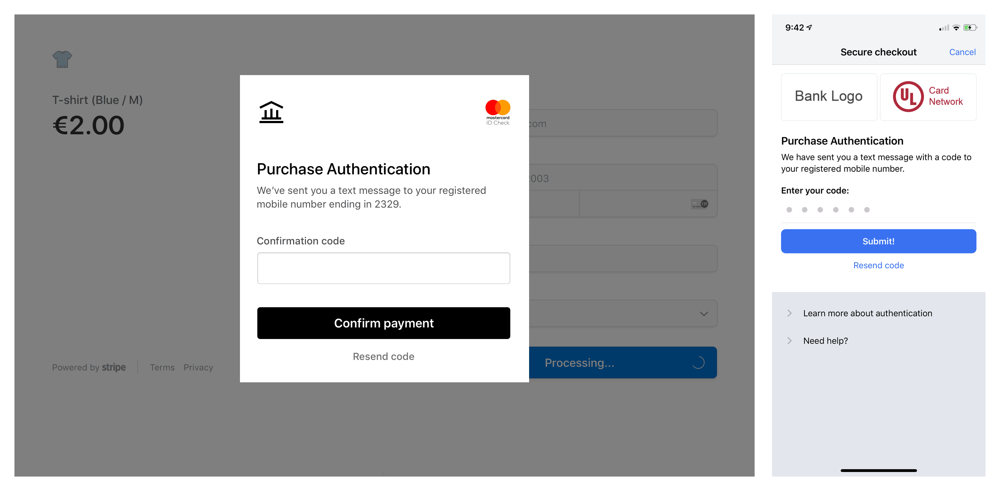
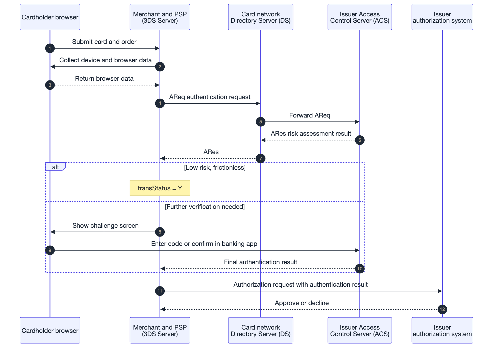
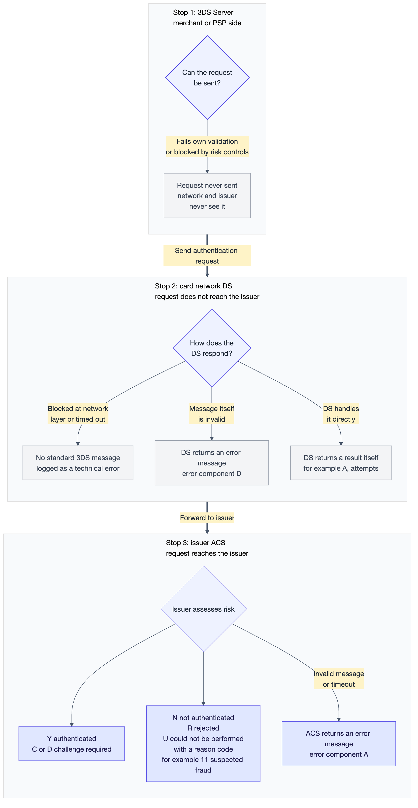
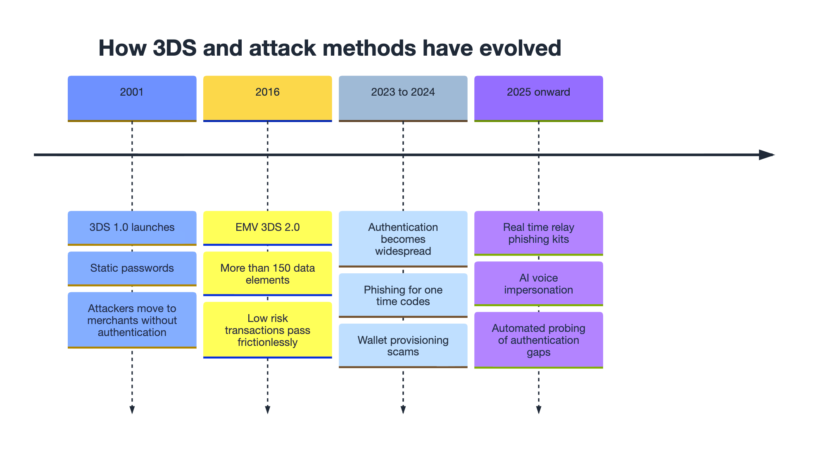
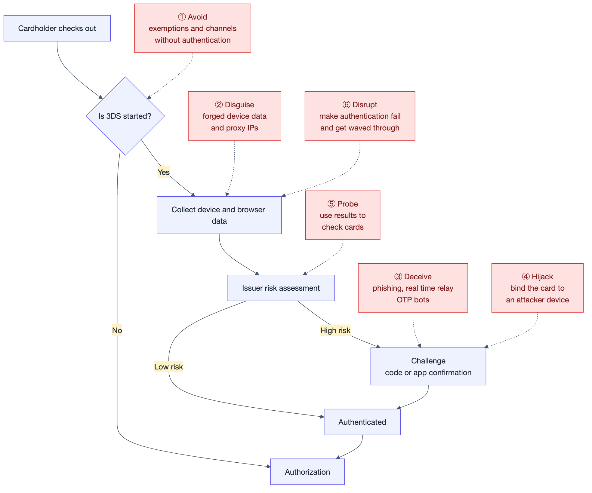
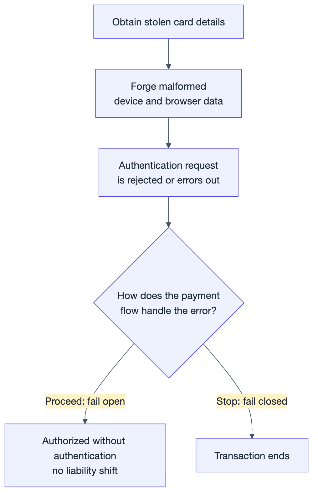
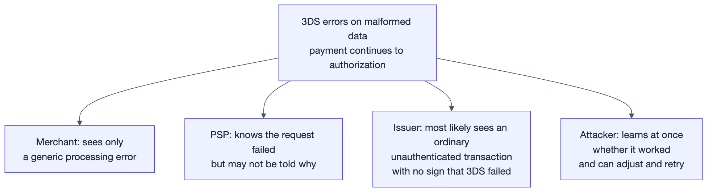
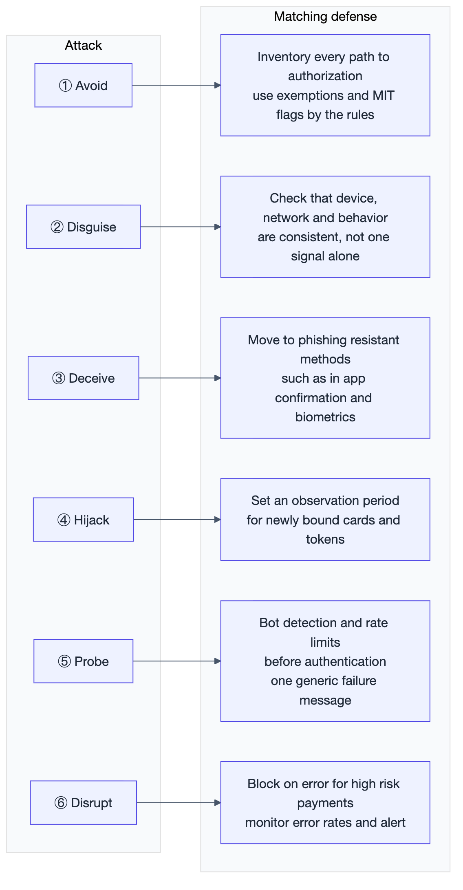

# Chapter 4: What 3DS Stops, and What It Misses

Any business that sells online to customers in more than one country ends up accepting cards from the international networks: Visa, Mastercard, American Express and others. With those cards comes 3DS. When a cardholder pays online and the issuer shows a window asking for a one time code, or a prompt to confirm in the banking app, that is 3DS at work. For more than twenty years it has been one of the most important defenses in online card payments, and public data shows that it works.

This chapter covers the authentication of international network cards in online, card not present payments. Domestic card schemes that run their own authentication methods are outside its scope.

The stronger a defense becomes, the more closely attackers study its edges. They no longer simply steal card numbers and spend them. They look for a way through at every step of the authentication flow. Some avoid authentication altogether, some disguise themselves as low risk customers, some trick cardholders into handing over their codes, some use 3DS as a tool for checking cards, and some try to make authentication fail. The spread of AI is making each of these probes cheaper, faster and easier to scale.

This chapter covers five things: how 3DS works; how requirements differ across markets; what the standard can and cannot tell you; the main methods attackers use against it today; and what businesses can do in response.

## 4.1 What 3DS is

3DS (3-D Secure) is a cardholder authentication protocol that the card networks designed for online card payments. The first version launched in 2001 [1]. Cardholders were redirected to a bank page to enter a static password, and many merchants and issuers saw it more as a barrier to conversion than as a fraud prevention tool [2].

In 2016, EMVCo, the body formed by the major card networks, published EMV 3DS 2.0 [1][3]. The biggest change was data. The number of data elements a merchant can send to the issuer grew from about 15 in 3DS 1.0 to more than 150, covering the device, the browser, the shipping address, transaction history and more [2]. Issuers use this data to assess risk. Low risk transactions pass in the background, which is called frictionless authentication. Only higher risk transactions require the cardholder to enter a code or confirm in an app, which is called a challenge [1][4].

Challenge screens are designed by each issuer, so they vary. Figure 4.1 shows two examples. At a web checkout, the authentication window of the issuer opens over the page and says that a code has been sent to the phone number on file; the payment completes only after the correct code is entered. In a mobile app the experience is similar, but the authentication screen is embedded in the app [5]. Some issuers instead send the cardholder to their banking app to confirm.

Figure 4.1: Examples of challenge screens. Left, an authentication window at a web checkout. Right, an authentication screen inside a mobile app (illustrative; source: Stripe documentation)

A typical browser based 3DS flow looks like this:

Figure 4.2: The EMV 3DS browser flow (simplified)

There are three key roles in the figure:

1. 3DS Server: usually run by the merchant or its payment service provider (PSP). It collects data and builds the authentication request (AReq).
2. Directory Server (DS): run by the card network. It routes the request to the right issuer.
3. Access Control Server (ACS): run on the issuer side. It assesses risk, decides whether a challenge is needed, and returns the result (ARes).

After authentication, the merchant includes the result in the authorization request. Successfully authenticated transactions usually qualify for liability shift, which means that fraud losses move to the issuer [6].

One detail will come up again later in this chapter. The browser and device data collected in steps 2 and 3 of Figure 4.2 is gathered by front end code running on the device of the cardholder. In other words, this data is reported by the client itself, and the merchant server has no way to guarantee at the source that it is genuine.

## 4.2 The rules differ by market

Whether 3DS is required varies widely from market to market:

1. European Economic Area and United Kingdom: Strong Customer Authentication (SCA) under PSD2 requires authentication for online card payments, and 3DS is the main way to meet it [7].
2. Japan: the Credit Card Security Guidelines published by the Ministry of Economy, Trade and Industry (METI) require, in principle, that all e-commerce merchants adopt EMV 3DS by the end of March 2025 [8].
3. Other markets, such as India and Australia, may also have rules that call for 3DS [7].
4. United States: there is no mandate, and 3DS is optional [7]. The picture also differs from Europe. An analysis of US transactions found that US issuers often treat transactions that request 3DS as higher risk, and are more likely to decline them outright than to put the customer through an unfamiliar authentication step [9].

So the same fraud strategy can perform very differently from one market to the next. Where 3DS is not mandated, transactions may not be authenticated at all, and fraud prevention relies more on the rules the merchant sets for itself. Where 3DS is mandated, exemptions and exception handling become the areas to watch.

Two more points matter especially for subscription businesses:

1. Subscription renewals are usually merchant initiated transactions (MITs) and generally do not go through 3DS. In Japan, for example, once 3DS is completed when the card is saved, later merchant initiated charges do not need 3DS again [10]. The first card setup and the first payment are therefore often the only authentication opportunity in the whole subscription lifecycle. If that step is compromised, every renewal after it goes through as normal.
2. Fraud and card testing traffic cost more than the losses themselves. Since June 2025, Visa has run a new acquirer monitoring program, VAMP, which measures each merchant every month on its ratio of fraud and disputes and on the share of its authorizations identified as enumeration attacks. Merchants and acquirers above the thresholds must take remediation steps [11]. For any business, this bears directly on whether its acquiring relationships stay stable.

## 4.3 What 3DS can tell you, and what it cannot

An authentication request passes through three stops in order: the 3DS Server on the side of the merchant or PSP, the Directory Server of the card network, and finally the Access Control Server of the issuer. The request can stop at any of them, and where it stops determines what information the merchant gets back.

The EMV 3DS specification defines three kinds of response [6][12]:

1. Transaction status (transStatus): Y authenticated, A attempts processing performed, N not authenticated, U could not be performed, R rejected, C challenge required, D decoupled authentication, I informational only.
2. Transaction status reason (transStatusReason): required when the status is N, U or R. Examples are 01 card authentication failed, 11 suspected fraud, and 22 ACS technical issue.
3. Error message (Erro): returned when the message itself has a problem. Examples are 101 message received invalid, 201 required data element missing, 203 format of one or more data elements is invalid, and 402 transaction timed out. Every error message carries an errorComponent field that identifies which party found the error: C is the 3DS SDK, S is the 3DS Server, D is the DS, and A is the ACS.

The specification allows both the ACS of the issuer and the DS of the card network to set the transaction status and reason, and it reserves reason codes 80 to 99 for use by the DS [6]. The same response value does not necessarily come from the issuer. By where the request stops, there are three cases:

1. Stopped on the side of the merchant or PSP. The 3DS Server never sends the request, for example because data validation failed or the risk controls of the provider blocked it. Neither the card network nor the issuer knows that the request existed. If the 3DS Server or SDK found an error, the error component is S or C.
2. Stopped at the card network, never reaching the issuer. The request reaches the DS but is not forwarded. Three outcomes are possible here. If the message format or a required field is wrong, the DS returns an error message with error component D. The DS may also handle the request itself and return a result directly; the specification allows attempts processing to be supported by the ACS or the DS [12], so an A in this case does not mean that the issuer ever saw the transaction. Finally, the request may be blocked by security controls at the network layer, or time out, in which case the merchant receives no standard 3DS message at all and can only log a technical error.
3. Reached the issuer. After assessing risk, the ACS returns a status such as Y, N, R, U, C or D, with a reason code when the status is N, U or R. If the ACS finds a problem with the message or times out, the error component is A.

Figure 4.3: Where a 3DS request can stop, and what each stop can return. Grey means that the request never reached the issuer; blue means that it did

Taken together, the three stops reveal several structural blind spots.

First, the transaction status alone does not tell you whether the issuer assessed the transaction. An A or a U may come from the issuer or from the card network [6][12].

Second, risk judgments such as suspected fraud only appear once the request has actually reached the issuer and the issuer has completed its assessment. When the request ends at either of the first two stops, the merchant gets no risk opinion from the issuer at all.

Third, an error message tells you who found the problem and what the problem was, but not why it happened. The error component tells you whether the DS or the ACS caught it, and the error code tells you whether a field was malformed or something timed out. A legitimate request with a formatting error caused by a front end compatibility problem, and an attack request deliberately crafted to be malformed, can look identical at the level of the error message.

Fourth, a request that is blocked or times out at the network layer leaves no standard message to look at. The merchant can only log a technical error, without knowing where the request stopped or why.

Fifth, successful authentication only shows that this verification passed, not that the person who passed it was the cardholder. If the code was phished, or a device belonging to the attacker has been enrolled as the authentication device, 3DS will correctly report success.

So the standard has success, failure and error, but no field that says "this is an attack". That is not a flaw in the specification. 3DS is designed to authenticate cardholders, not to detect attack traffic. It does mean that detecting attacks has to be done by other parts of the payment flow.

## 4.4 How attackers work around 3DS, then and now

3DS does work. A joint 2024 report by the European Banking Authority (EBA) and the European Central Bank (ECB) shows that transactions authenticated with SCA have lower fraud rates than unauthenticated ones, especially for card payments, and that card fraud rates are about ten times higher when the counterpart is outside the EEA, where SCA may not be required [13].

When the defense gets stronger, attackers change route. An EBA opinion from 2024 puts it plainly: SCA has succeeded in curbing fraud based on stolen credentials, but fraudsters have moved to more sophisticated techniques, including manipulating the payer, phishing combined with persuading the victim to approve the payment, and attacks on the process for enrolling authentication devices [14].

Figure 4.4: How 3DS and attack methods have evolved

Putting together the cases in public reports, the common attacks today fall into six paths, each acting at a different point in the 3DS chain:

Figure 4.5: Where the six attack paths act on the 3DS chain

### ① Avoid: keep 3DS from happening

The most direct approach is to go where there is no 3DS. Attackers use stolen cards at merchants or in regions that do not require authentication, or exploit transaction types that do not need it. EBA and ECB data show higher fraud rates for some SCA exemptions, and for transaction types outside the scope of SCA [13].

Exemptions are a legitimate and necessary part of the design. Examples include the low value exemption, the transaction risk analysis exemption, and merchant initiated transactions such as subscription charges. Note, however, that transactions where an exemption is granted, and transactions flagged as MITs, do not get liability shift [15]. If these channels are abused, the merchant bears the loss.

For any single merchant, the weakest channel sets the overall level of risk. A payment security vendor points out that even when the main checkout has strict authentication, attackers will find any legacy endpoint that can still send an authorization directly, or any card setup flow that skips authentication [16].

### ② Disguise: look like a low risk customer

Frictionless authentication in 3DS 2.0 depends on how the issuer reads the data. For an attacker who does not have the phone of the cardholder, a challenge usually means failure. So attackers work hard to make their requests look normal: they forge common browser and device characteristics, and hide their real origin behind proxy networks.

Public analysis notes that if a bot submits device data that is realistic enough, and happens to use a real and valid card, it can still pass authentication without a challenge [16]. Visa guidance to merchants specifically recommends device fingerprinting tools that can detect proxies [17].

### ③ Deceive: get the code from the cardholder

If only the cardholder receives the code, the attacker goes after the cardholder. This has been the most active path in recent years.

1. Classic phishing: attackers impersonate a delivery service or a bank and lure cardholders into entering card numbers and codes on fake pages. In a 2025 report, Visa named this kind of one time password bypass scam as one of its key threats [18].
2. Real time relay: in 2026 the security firm Group-IB disclosed a phishing as a service kit called Milk Dragon. It draws victims in with social media ads for heavily discounted goods, captures what they type on fake e-commerce checkout pages in real time, shows a fake verification page matching the issuer of the victim, and relays the code to an operator who completes a real transaction. Since October 2025, researchers have found 258 phishing pages, with victims in 66 countries [19].
3. Page injection: attackers inject malicious scripts into compromised legitimate websites to steal card data entered at checkout. Recorded Future estimates that more than 10,500 such web skimmers were active in 2025, potentially affecting more than 23 million online transactions [20].
4. Voice impersonation: the US Federal Bureau of Investigation (FBI) warns that criminals use AI generated voices to impersonate others and gain access to bank accounts [21].

The annual report from Recorded Future sums up the trend: intercepting one time passwords has become the main way to bypass authentication, and it is often used to fill gaps in other fraud schemes [20]. The same report found that the share of stolen card records sold on the dark web that include contact details rose to 82% [20], which makes targeted phishing of cardholders easier.

### ④ Hijack: bind the card to a device the attacker controls

One step beyond phishing a single code is taking over the ability to authenticate altogether.

The EBA describes this as an attack on the enrollment process. The fraudster obtains the credentials of the cardholder through phishing, text message or phone scams, then registers a device of their own as the second authentication factor, taking full control of the account and making multiple fraudulent transactions [14].

A typical variant is the mobile wallet provisioning scam. After entering card details on a phishing site, the cardholder is told that the bank needs to send a code to confirm a small transaction. In fact, the code is the one the bank sends to confirm adding the card to a mobile wallet. Once the victim shares it, the card is loaded onto the phone of the attacker [22]. The Association of Banks in Singapore issued a public advisory about this in February 2025, and announced that major card issuers would add extra verification, such as in app confirmation, before a card can be added to a mobile wallet [23]. Visa has also observed attackers increasingly waiting a week or more after provisioning before they start spending, to avoid monitoring aimed at new tokens [18].

### ⑤ Probe: use 3DS to check cards

The goal of this path is not to spend, but to check cards. Attackers hold large numbers of card numbers of unknown origin and validity, and they need a cheap, fast way to find the ones that work.

Public sources show that attackers use scripts to submit card setup or small payment requests in bulk, then read the 3DS or issuer responses to tell which cards are valid [24]. Because authentication happens before authorization, the authentication result itself can leak information even if no charge is ever attempted. A 2026 paper on arXiv analyzes this "3DS oracle" problem, and cites a Mastercard patent application describing how fraudsters can start transactions with guessed card numbers and use the signals returned by the authentication step to tell which numbers belong to real accounts [25].

The scale is significant. Visa reported a 22% increase in suspected enumeration transactions over six months [18], and Recorded Future estimates that card checking services run on Telegram validated at least 27 million card records in 2025 [20].

### ⑥ Disrupt: make authentication fail

The last path is the most subtle. Instead of avoiding 3DS or deceiving the cardholder, the attacker tries to make 3DS itself fail.

It exploits a very common design choice: what should the payment flow do when 3DS cannot complete for technical reasons? A public reference for the EMV 3DS specification suggests that, for the "could not be performed" status, the requestor can retry or proceed to authorization without liability shift [6]. Some payment flows choose to proceed, so that they do not lose legitimate orders to occasional technical failures. This design is usually called fail open, as opposed to fail closed.

Figure 4.6: The logic of an attack that makes authentication fail

If attackers find that certain malformed device or browser data makes the authentication request get rejected or return an error, and that the payment flow then proceeds anyway, they have a path to authorization without authentication. This attack is hard to spot because each party sees only one piece of the puzzle:

Figure 4.7: What each party sees after authentication fails

The merchant sees a generic processing error that is easy to dismiss as a technical issue. At authorization, the issuer most likely sees an ordinary unauthenticated e-commerce transaction. The only party with the full picture is the attacker, who learns the outcome of every request immediately and can adjust and try again.

### What the six paths have in common

All six paths exploit the blind spot described in Section 4.3: 3DS tells you the result of authentication, but not what happened behind it. A successful authentication may be the cardholder, or an attacker holding the code. A failure or an error may be a system fault, or someone probing.

## 4.5 How AI changes the pace of attack and defense

Why do these paths deserve more attention now? An important part of the answer is that AI is lowering the cost of each step for attackers.

On the deceive path, AI makes phishing content and impersonation more convincing and easier to localize. In a December 2024 public service announcement, the FBI warned that criminals are using generative AI to commit fraud on a larger scale, reducing the time and effort they need, including by using AI generated voices to impersonate others [21].

On the probe and disrupt paths, AI makes large scale trial and error easier. Anthropic disclosed that in September 2025 a cyber espionage group used its AI coding tool to build an automated attack framework. With humans making only a few key decisions, the AI carried out about 80% to 90% of the tactical work, including reconnaissance, finding and validating vulnerabilities, and writing exploit code. At its peak, it often made multiple requests per second [26][27].

Across the fraud industry, the Spring 2026 threats report from Visa says that attackers use AI to automate workflows at scale and to iterate and adapt quickly [28]. In autumn 2025, Visa also noted that fraud has evolved from opportunistic crime into systematic, industrialized operations, with criminals building infrastructure they can reuse across attack types [29]. Recorded Future observes that attackers are actively building AI into the fraud attack chain, and warns that agentic commerce, where AI agents shop on behalf of users, turns the intent of the user and the intent of the agent into a new attack surface [20].

Putting this together, our view is that exemption rules, error handling and fallback logic in payment flows are exactly where automated tools are strongest. Finding which channel skips authentication, which data makes authentication fail, and whether the system proceeds after a failure used to take an experienced, patient attacker trying things by hand. Today that kind of large scale, low cost trial and error can be handed to automated scripts, or even to AI agents. Meanwhile, phishing as a service kits such as Milk Dragon package real time relay, which once required specialist skills, into a product that anyone can subscribe to [19].

## 4.6 What businesses can do

No single measure addresses all six paths. A practical approach is to put the matching defense in place for each one:

Figure 4.8: The six attack paths and matching defenses

1. Avoid: take an inventory of every channel that can reach authorization, including legacy endpoints, card setup flows and any condition that skips authentication. Use exemptions and MIT flags according to card network rules, and do not flag ordinary transactions as exempt from authentication [15][16].
2. Disguise: do not rely on a single signal. Whether the device, network and behavior are consistent with each other often says more than any one field [17].
3. Deceive: on the issuer side, gradually replace text message codes with methods that are harder to phish, such as in app confirmation and biometrics [23]. On the merchant side, protect checkout pages against malicious script injection.
4. Hijack: set an observation period for newly enrolled devices and for cards newly added to mobile wallets. The EBA recommends a delay before a new device becomes active, and prompt notifications to devices that are already enrolled [14]. Visa also recommends that issuers factor the age of a token into risk decisions [18].
5. Probe: run bot detection and rate limiting before starting authentication, show a single generic failure message to the outside world, and keep detailed reason codes in internal logs [16]. Visa also recommends monitoring 3DS transactions for anomalies such as sudden spikes on particular BIN ranges [30].
6. Disrupt: do not let every authentication error through. For known low risk customers, proceeding on error reduces false declines. For high risk transactions, or those with clearly abnormal device and browser data, blocking or asking for authentication again is the safer choice. Monitor the rates of "could not be performed" and other errors against your own history and against peers, and treat a sudden rise as a risk signal to investigate.

Beyond these six, three things are worth doing for any business that sells across markets:

1. Look at the data by market. The same rule can perform very differently in Europe or Japan, where 3DS is mandated, and in the United States, where it is not. Break down authentication, decline and dispute rates by the country where the card was issued, rather than looking only at the global average.
2. For subscriptions, treat the first card setup as the gate. Renewals generally skip authentication, so controls at card setup and the first payment should be stricter than for one off purchases. Have a process to review and act on cards that were saved despite clear risk signals at the time.
3. Track card network monitoring metrics. Follow the ratio of fraud and disputes, and the scale of card testing, every month, rather than finding out that a threshold has been breached when the acquirer gets in touch [11].

Finally, keep talking to your payment service provider. Many details are visible only to the provider, such as the step at which a request failed and what the data looked like before and after. When you spot an anomaly, sharing sample transactions early helps find the cause faster.

It is also worth asking yourself regularly: if someone deliberately made every check in my system fail or return an error, would my system end up letting the payment through, or stopping it?

## 4.7 Summary

3DS has made online payments much safer, and public data supports that. But every defense has edges, and AI is helping attackers find them faster.

We used to care whether authentication passed. Now we also need to care who passed it, why it did not complete, and what we did when it did not. In payment security, the exception path is part of the main path.

## References

1. Stripe, 3D Secure 2 guide: https://stripe.com/guides/3d-secure-2
2. Broadcom, EMV 3-D Secure: Enhanced Data Driving Better Customer Experiences: https://docs.broadcom.com/doc/emv-3-d-secure-enhanced-data-driving-better-customer-experiences
3. Wikipedia, 3-D Secure: https://en.wikipedia.org/wiki/3-D_Secure
4. Visa, 3D Secure: your guide to safer transactions: https://corporate.visa.com/en/solutions/visa-protect/insights/3d-secure.html
5. Stripe, Authenticate with 3D Secure: https://docs.stripe.com/payments/3d-secure/authentication-flow
6. EMV 3DS Specification Full Reference (v2.3.1.1): https://3dsspec.com/exports/3ds-spec-full.md
7. Stripe, 3D Secure authentication: https://docs.stripe.com/payments/3d-secure
8. Ministry of Economy, Trade and Industry (Japan), Revision of the Credit Card Security Guidelines (March 2024, in Japanese): https://www.meti.go.jp/press/2023/03/20240315002/20240315002.html
9. Stripe, Surprising findings from our analysis of 3DS transactions in the US: https://stripe.com/blog/surprising-findings-from-our-analysis-of-3ds-transactions-in-the-us
10. Stripe, Japan 3DS mandate exemptions: https://docs.stripe.com/payments/3d-secure/japan-exemptions
11. Visa, Visa Acquirer Monitoring Program Fact Sheet 2025: https://corporate.visa.com/content/dam/VCOM/corporate/visa-perspectives/security-and-trust/documents/visa-acquirer-monitoring-program-fact-sheet-2025.pdf
12. 3DSecure.io, Specification 2.2.0: https://docs.3dsecure.io/3dsv2/specification_220.html
13. EBA and ECB, 2024 Report on Payment Fraud: https://www.eba.europa.eu/sites/default/files/2024-08/465e3044-4773-4e9d-8ca8-b1cd031295fc/EBA_ECB%202024%20Report%20on%20Payment%20Fraud.pdf
14. EBA, Opinion on new types of payment fraud and possible mitigations (April 2024): https://eba.europa.eu/sites/default/files/2024-04/363649ff-27b4-4210-95a6-0a87c9e21272/Opinion%20on%20new%20types%20of%20payment%20fraud%20and%20possible%20mitigations.pdf
15. Stripe, Strong Customer Authentication exemptions: https://docs.stripe.com/payments/3d-secure/strong-customer-authentication-exemptions
16. GPayments, Where 3D Secure Helps Against Card Testing: https://www.gpayments.com/blog/article/3ds-card-testing-attacks/
17. Visa, Anti-Enumeration and Account Testing Best Practices: Considerations for Merchants: https://usa.visa.com/content/dam/VCOM/global/support-legal/documents/anti-enumeration-and-account-testing-best-practices-merchant.pdf
18. Visa PERC, Biannual Threats Report (Spring 2025): https://corporate.visa.com/content/dam/VCOM/corporate/solutions/documents/visa-perc-biannual-report-spring-2025.pdf
19. Group-IB, Milk Dragon: Huge Discounts on Social Media? Think Twice Before You Buy (October 2026): https://www.group-ib.com/blog/milk-dragon/
20. Recorded Future, Annual Payment Fraud Intelligence Report 2025: https://assets.recordedfuture.com/Reports/Annual_Payment_Fraud_Intelligence_Report_2025.pdf
21. FBI IC3, Criminals Use Generative Artificial Intelligence to Facilitate Financial Fraud (I-120324-PSA): https://www.ic3.gov/PSA/2024/PSA241203
22. Krebs on Security, How Phished Data Turns into Apple & Google Wallets (February 2025): https://krebsonsecurity.com/2025/02/how-phished-data-turns-into-apple-google-wallets/
23. Association of Banks in Singapore, Major card issuing banks to step up measures to combat card provisioning scams (February 2025): https://www.abs.org.sg/docs/library/major-card-issuing-banks-to-step-up-measures-to-combat-card-provisioning-scams.pdf
24. Stripe, Protect yourself from card testing: https://docs.stripe.com/disputes/prevention/card-testing
25. arXiv, The 3DS Oracle: BIN Attack via the Network: https://arxiv.org/html/2610.32206
26. Anthropic, Disrupting an AI-orchestrated cyber espionage campaign: https://www.anthropic.com/news/disrupting-AI-espionage
27. Anthropic, Full report: Disrupting the first reported AI-orchestrated cyber espionage campaign: https://www-cdn.anthropic.com/d7dd50dd1185f59be051b307150d877f2b82bd2c.pdf
28. Visa, Spring 2026 Biannual Threats Report: https://corporate.visa.com/content/dam/VCOM/corporate/visa-perspectives/newsroom/documents/visa-spring-biannual-threats-report-2026.pdf
29. Visa, Ahead of Holiday Season, Visa Identifies Five Transformative Forces Reshaping Global Payment Security: https://visa.gcs-web.com/news-releases/news-release-details/ahead-holiday-season-visa-identifies-five-transformative-forces
30. Visa, Guidance to Guard Against Enumeration Attacks and Account Testing Schemes: https://usa.visa.com/content/dam/VCOM/global/support-legal/documents/visa-guidance-to-guard-against-enumeration-sept.pdf
